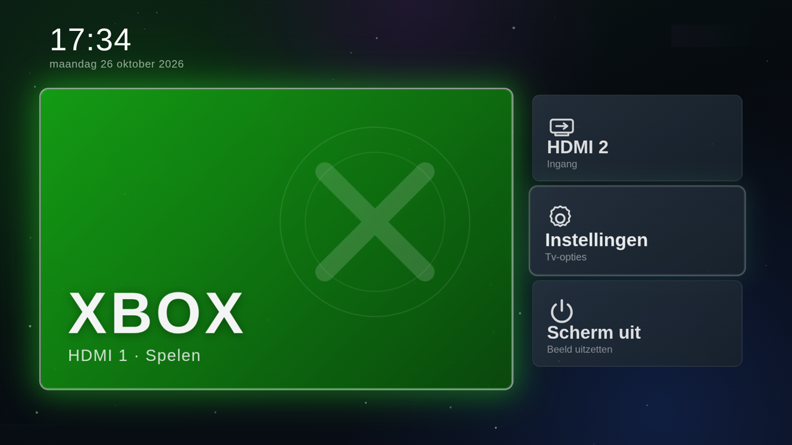
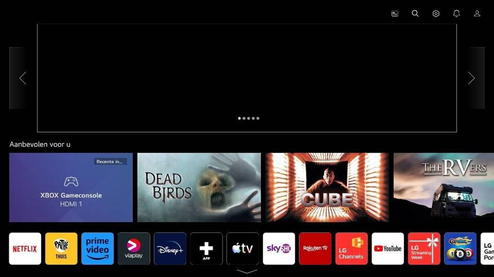
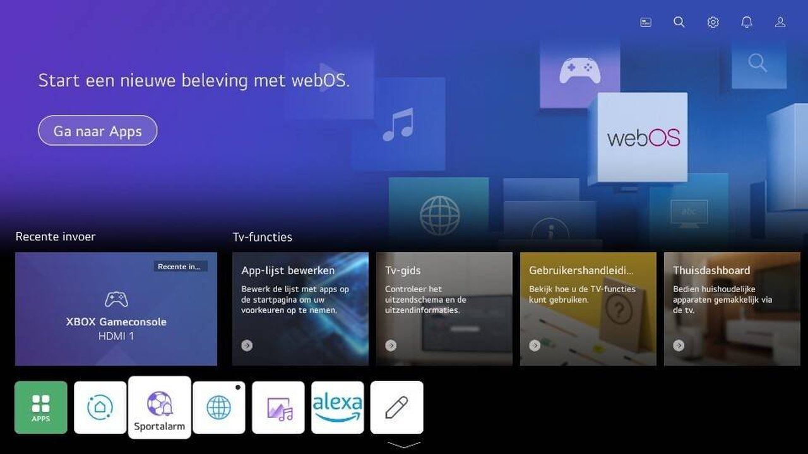
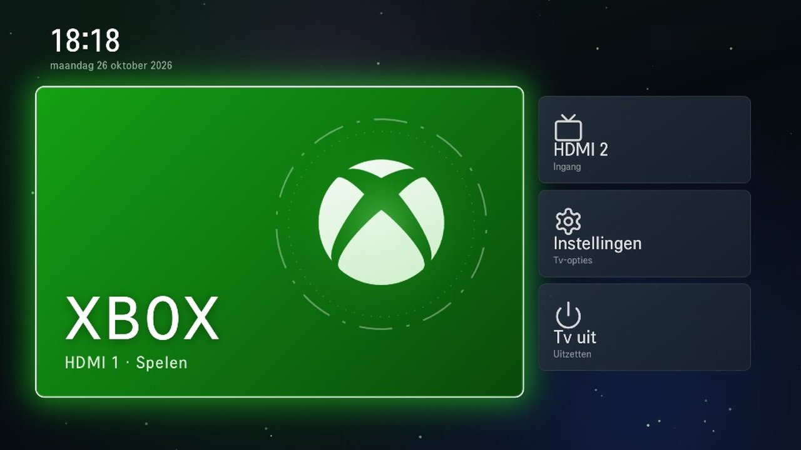

# webos-console-home

A console-style home screen for LG webOS TVs. It is a single web app written in vanilla JavaScript that starts on the TV and offers large tiles for an HDMI input (such as a game console), a second input, the TV settings and a screen-off action.



## Before and after

Captured on the TV itself (LG 55UP77006LB, webOS 6.5) with `tvctl.py`.

| Stock LG home | Ads and apps removed | Console home |
| --- | --- | --- |
|  |  |  |

1. **Stock:** recommended content, ad banners and a row of preinstalled streaming apps.
2. **Cleaned:** preinstalled apps removed and all advertising and tracking options switched off in the TV settings.
3. **Console home:** this project, started automatically by the home-server daemon.

## Features

- Animations use only `transform` and `opacity`, so they stay smooth on the TV's weak GPU.
- Full navigation with the standard remote: arrow keys to move, OK to select.
- Plain HTML, CSS and ES2019 JavaScript (no build step), compatible with the Chromium 79 engine used by webOS 6.
- Optional home-server daemon that starts the app automatically when the TV turns on.

## Requirements

- An LG TV running webOS. Tested on webOS 6.5 (LG 55UP77006LB).
- LG Developer Mode on the TV. Root access is not needed.
- Node.js, for the `@webos-tools/cli` command line tools.
- Python 3.9 or newer, only for the optional daemon and the helper scripts.

## Setup

1. **Enable Developer Mode.** Install the "Developer Mode" app from the LG Content Store on the TV, sign in with an LG developer account, switch on "Dev Mode Status" and "Key Server", and restart the TV. The app shows the TV's IP address and the key server passphrase.

2. **Install the CLI tools.**

   ```
   npm install -g @webos-tools/cli
   ```

3. **Add the TV as a device.** Use the IP address shown in the Developer Mode app. Port 9922 and user `prisoner` are the defaults.

   ```
   ares-setup-device --add tv -i "host=192.168.1.20" -i "port=9922" -i "username=prisoner"
   ```

4. **Fetch the SSH key.** This downloads the key from the TV's key server, protected by the passphrase from the Developer Mode app.

   ```
   ares-novacom --device tv --getkey
   ares-setup-device -m tv -i "passphrase=YOUR_PASSPHRASE"
   ```

5. **Edit `launcher/config.js`.** Set `hubUrl` to the address of the home-server daemon (see below), or leave the example value if you do not use it. `name` is an optional text for the top bar and is hidden when empty. The date follows the TV's menu language; set `locale` (for example `'en-US'`) to use a different one.

6. **Package and install.**

   ```
   ares-package launcher -o dist
   ares-install -d tv dist/io.github.webosconsole.home_*.ipk
   ares-launch -d tv io.github.webosconsole.home
   ```

To use a different app id, change `id` in `launcher/appinfo.json` and set the same value in `APP_ID` for the daemon.

## Optional: home-server daemon

A web app installed through Developer Mode does not start by itself when the TV turns on, and the Luna service `tvpower` rejects calls from third-party apps, so the app cannot switch the screen off on its own. `nuc/tvhome.py` runs on any always-on machine in your network (a NAS, a mini PC, a Raspberry Pi) and solves both:

- It watches the TV and launches the app when the TV becomes active and the home screen is in the foreground.
- It serves a small HTTP endpoint. `GET /off` turns the TV off, `GET /screenoff` turns off the screen only, and `GET /health` reports the connection state. The launcher calls `/off` from the "Tv uit" tile and falls back to Luna when the daemon is unreachable.

The endpoint has no authentication. Run it only on a trusted local network.

### Install

```
python3 -m venv .venv
.venv/bin/pip install -r requirements.txt
```

### Pair with the TV

```
export TV_HOST=192.168.1.20
.venv/bin/python pair.py
```

Accept the prompt on the TV. The client key is written to `client_key.json` in the repository root, or to the path in `TV_KEY_FILE`. The file is excluded from git.

### Environment variables

| Variable | Default | Meaning |
| --- | --- | --- |
| `TV_HOST` | none (required) | IP address of the TV |
| `TV_KEY_FILE` | `client_key.json` in the repository root | Path of the client key file |
| `APP_ID` | `io.github.webosconsole.home` | App id the daemon launches |
| `HUB_PORT` | `8787` | Port of the HTTP endpoint |

### systemd

`nuc/tvhome.service` is a user unit. It expects the repository in `~/tv` with a virtualenv in `~/tv/.venv`. Set `TV_HOST` (and the optional variables) in the `Environment=` lines, then:

```
mkdir -p ~/.config/systemd/user
cp nuc/tvhome.service ~/.config/systemd/user/
systemctl --user daemon-reload
systemctl --user enable --now tvhome.service
loginctl enable-linger "$USER"
```

## Developer Mode expiry

Developer Mode expires after 1000 hours, after which the installed app stops working until the session is extended. `nuc/extend_devmode.py` extends the session with `ares-launch -d tv com.palmdts.devmode -p extend=true`. It only acts when the last extension is more than 7 days old and the launcher is in the foreground, so it does not interrupt anything you are watching. It then relaunches the app and records the time in `.devmode_extended`. Run it from cron, for example every hour:

```
0 * * * * TV_HOST=192.168.1.20 /home/user/tv/.venv/bin/python /home/user/tv/nuc/extend_devmode.py
```

The script needs `ares-launch` on the `PATH` (or set `ARES` to its full path) and the device name `tv` from step 3.

## Remote control and screenshots

`tvctl.py` sends remote keys and saves a screenshot to `shots/s.jpg`:

```
TV_HOST=192.168.1.20 .venv/bin/python tvctl.py RIGHT wait ENTER
```

## Trademarks and credits

The Xbox logo is taken from [simple-icons](https://github.com/simple-icons/simple-icons) (CC0). Xbox is a trademark of Microsoft Corporation. This project is not affiliated with, endorsed by or sponsored by Microsoft. LG and webOS are trademarks of LG Electronics, and this project is not affiliated with LG either. The other icons are from [Lucide](https://lucide.dev) (ISC license).

## License

MIT, see [LICENSE](LICENSE).
